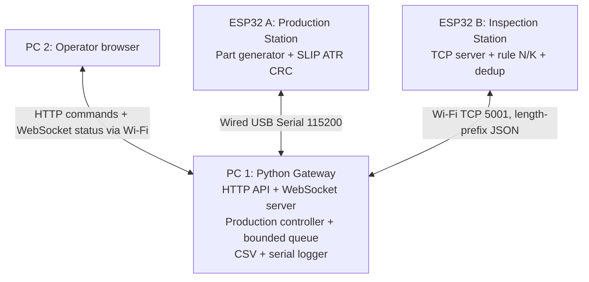

# Architecture diagram

Notes:

- The two ESP32s do not exchange traffic directly during Milestone 1.
- The gateway computer can use its own Wi-Fi hotspot or a local 2.4 GHz router.
- PC 2 needs only a browser; Python application code runs on PC 1.
- Report serial as a **wired** point-to-point connection, separately from Wi-Fi TCP and operator traffic.
- For state chart, see `MESSAGE_SPEC.md`.
