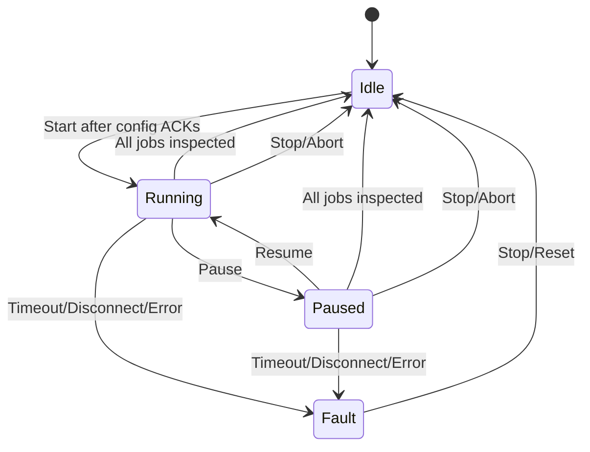

# Protocol & state design specification (team-chosen details)

## Milestone 1 mandated links

- **ESP32 A ↔ Gateway:** wired USB serial, SLIP framing, ATR with CRC and sequence numbers.
- **ESP32 B ↔ Gateway:** Wi-Fi TCP with custom application messages and length-prefix framing.
- **Operator ↔ Gateway:** HTTP request commands and WebSocket real-time status.

## Shared identifiers

- Every gateway-originated command has a new `cmd_id`: e.g. `A-552148734...`, `B-config-552148734...`.
- Every part/job has one `job_id`: `B<batch_id>-P<part_id>` e.g. `B1-P3`. The **same string** crosses serial and TCP protocol boundaries.
- Every ATR serial frame includes a monotonically increasing **wire** `seq` (4-byte unsigned integer), independent of the **logical** job ID. Retransmitting a job uses the same `job_id` but can have a fresh wire `seq`.
- Heartbeats carry `heartbeat_id` for traceability; heartbeat is not a work command/job.

## ESP32 A USB: SLIP + ATR + CRC

Serial setting 115200, 8-N-1. One serial frame:

```text
SLIP END (C0)
    2-byte test_id (big-endian; production uses 1)
    4-byte seq (big-endian)
    2-byte payload_len (big-endian)
    payload_len bytes ASCII JSON application payload
    2-byte CRC16 (big-endian) over header + payload
SLIP END (C0)
```

SLIP escaping within frame: `C0 → DB DC`, `DB → DB DD`. Serial sender and receiver reject invalid ATR length or CRC. CRC variant: **CRC-16/CCITT-FALSE (poly 1021, initial FFFF, no reflection, xorout 0000)**. This variant is a documented **team selection**; the PDF does not specify a CCITT variant.

Example application message carried inside ATR:

```json
{"type":"PART","job_id":"B1-P3","batch_id":1,"part_id":3}
```

Do **not** send ASCII `printf` logs on ESP32 A UART0 after firmware boots; they'll interfere with the binary stream. Gateway log captures decoded frames and their hex representation. Production payload JSON is an application-layer team choice within the ATR envelope; the fixed benchmark ATR payload pattern belongs to Milestone 2.

## ESP32 B TCP

Every TCP application message is:

```text
[4-byte unsigned big-endian JSON byte count][UTF-8 JSON bytes]
```

A receiving socket must buffer arbitrarily split/coalesced TCP bytes until a whole record has arrived. Max body: 2048 bytes on ESP32 B (4096 bytes in Python receiver). TCP port `5001` by default.

### Commands and messages

| Name | Sender | Fields | Meaning |
|---|---|---|---|
| `CONFIG` | Gateway → A | `cmd_id`, `production_ms` | Set part cycle time without reflashing |
| `START` | Gateway → A | `cmd_id`, `batch_id`, `target` | Begin named production batch |
| `PAUSE`, `RESUME`, `STOP` | Gateway → A | `cmd_id` | Run-state control |
| `PART` | A → Gateway | `job_id`, `batch_id`, `part_id` | A produced a virtual part |
| `CONFIG` | Gateway → B | `cmd_id`, `n`, `k`, `inspection_ms` | Set rule and inspection time at runtime |
| `CANCEL_BATCH` | Gateway → B | `cmd_id`, `batch_id` | Abort active inspection during Stop |
| `BEGIN_BATCH` | Gateway → B | `cmd_id`, `batch_id`, `target` | Prepare result/duplicate ledger |
| `INSPECT` | Gateway → B | `job_id`, `part_id`, `batch_id` | Ask B to calculate verdict |
| `ACK` | Either way | `ref_id`, `phase`, `status`, optional `result` | Distinct delivery, acceptance, completion acknowledgements |
| `HEARTBEAT` | A/B → Gateway | `device`, `heartbeat_id`, optional pending_job_id | Connection freshness |

### Three distinct stages

For an inspection job sent from Gateway to B:

```text
Gateway --INSPECT(job_id=B1-P3)----------------> ESP32 B
Gateway <--ACK(DELIVERY, ref_id=B1-P3)--------- ESP32 B
Gateway <--ACK(ACCEPTANCE, ref_id=B1-P3)------- ESP32 B
                      [simulation timer + N/K]
Gateway <--ACK(COMPLETION, ref_id=B1-P3,
               status=OK, result=FAIL)--------- ESP32 B
```

For ESP32 A's PART message, the gateway similarly acknowledges `DELIVERY` when a valid serial frame arrives, `ACCEPTANCE` once queued, and `COMPLETION` only after B returns a matching inspection verdict. `BLOCKED` is a **temporary non-acceptance** status: it is not a completed job.

### Duplicate prevention and retries

- Gateway remembers every active-batch job ID and only schedules each job once.
- ESP32 A remembers recent command IDs and does not execute them twice.
- ESP32 B stores verdict bits for up to 1000 numbered parts in the active batch. On duplicate INSPECT, return the recorded result or acknowledge already-in-progress work without starting again.
- Gateway sends identical command/job IDs in up to 3 attempts on timeout. Serial A retransmits the same PART ID up to 3 attempts unless explicit backpressure is active.
- A pending part subject to backpressure is periodically mentioned in A heartbeats so the gateway can re-send missing ACCEPTANCE ACK.
- Gateway faults after 8s missing connection freshness, rather than trusting stale values.
- A/B state is held in memory; an ESP32 power-cycle cannot promise duplicate memory persistence. Device loss results in Fault and the next run starts a new batch.

## Queue and operating states

Gateway `capacity=5` by default. A maximum of `capacity` queued jobs is allowed, plus up to **one produced but unaccepted** part waiting outside the queue due to backpressure. Only one inspection is active at a time. On each inspection dequeue, gateway admits the blocked part and issues an ACCEPTANCE ACK.

- **Idle:** can configure and begin a new batch; last report may remain displayed.
- **Running:** new parts produced, jobs queued/inspected.
- **Paused:** ESP32 A stops generating new parts. Already-queued and current inspection jobs **continue**; this policy is documented and intentional.
- **Fault:** gateway does not accept new work, and sends best-effort STOP to ESP32 A. Recover via Stop to Idle and a new batch.
- **Stop:** abort the batch. Reports ABORTED, never COMPLETED.
- **Normal completion:** target parts produced, each inspected, accepted + rejected = target; transition to Idle and report COMPLETED.

### State diagram



## Operator endpoints

- `POST /api/start` with body: `{"target":10,"production_ms":500,"inspection_ms":1000,"n":4,"k":1}`
- `POST /api/pause`, `/api/resume`, `/api/stop` with `{}`
- `GET /api/status` returns state, counters, queue and connectivity.
- `GET /ws` upgrades to WebSocket and receives periodic JSON status snapshots.

The HTTP server is a **local prototype without authentication**; put it on the isolated hotspot. Basic authenticated MQTT access is Milestone 2, not included here.

## Instructor-changeable settings

The instructor assigns `production_ms`, `inspection_ms`, `n`, and `k` at the start of demonstration; the operator specifies `target`. The source PDF explicitly requires runtime configuration without hardcoding and validated command transfer to B. This starter safely applies settings at **batch start**; it does not support editing fields on an active running/paused batch. Any live changes in the final version should be separately defined and acknowledged before affecting subsequent jobs.
